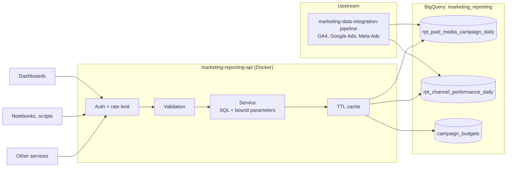

# marketing-reporting-api

A read-only REST API that serves marketing KPIs from BigQuery reporting tables: period
summaries with comparisons, time series, campaign leaderboards, channel and platform
comparisons, and budget pacing.

Built with **FastAPI**, **BigQuery** and **SQL**, packaged in **Docker**. It ships with seed data
and a local database, so it runs with no cloud account:

```bash
docker compose up --build
curl -H "X-API-Key: local-dev-key" "http://localhost:8000/v1/kpis/summary?start_date=2026-10-01&end_date=2026-10-31"
```

Interactive documentation is generated at `http://localhost:8000/docs`.

> **Status in one line:** the API, its 99 tests and all eight SQL queries are verified locally,
> and every query has been run in BigQuery with results identical to the local backend. The
> Python BigQuery client path and the Cloud Run deployment have not been run against a real
> project. See [What is verified](#what-is-verified).

## Where it fits



The tables come from my
[marketing-data-integration-pipeline](https://github.com/Guri-L/marketing-data-integration-pipeline)
project. This API is the layer that lets dashboards and other tools use them without each one
holding BigQuery credentials or re-implementing metric definitions.

## Endpoints

All `/v1` endpoints need an `X-API-Key` header. Dates are `YYYY-MM-DD`; without dates, the
period is the latest 30 days that have data.

| Endpoint | Returns |
| --- | --- |
| `GET /v1/kpis/summary` | Totals and ratios for a period, the same-length period before it, and the change between them |
| `GET /v1/kpis/timeseries` | KPIs per `day`, `week` (Monday start) or `month` |
| `GET /v1/campaigns` | Campaign leaderboard: sort by 12 fields, search by name, paginate; includes spend share and rank |
| `GET /v1/campaigns/{campaign_id}` | One campaign: totals plus daily figures with a 7-day moving average of spend |
| `GET /v1/channels` | Site performance by channel, paid and unpaid, with shares and rates |
| `GET /v1/platforms` | Google Ads and Meta Ads side by side, with the gap between platform-claimed and GA4 revenue |
| `GET /v1/pacing` | Projected month-end spend against each campaign's budget: over, under or on track |
| `GET /v1/meta` | Date range and size of the available data |
| `GET /health`, `GET /ready` | Liveness, and readiness (checks the warehouse). No key needed |

Common parameters: `start_date`, `end_date`, `platform` (`google_ads` or `meta_ads`).

### Example

```bash
curl -H "X-API-Key: local-dev-key" \
  "http://localhost:8000/v1/kpis/summary?start_date=2026-10-01&end_date=2026-10-31"
```

```json
{
  "data": {
    "period": {"start_date": "2026-10-01", "end_date": "2026-10-31"},
    "current": {
      "impressions": 7389363, "clicks": 110216, "spend": 65186.56,
      "conversions": 3984.47, "conversion_value": 245935.34,
      "sessions": 88710, "transactions": 2562, "revenue": 154171.47,
      "ctr": 0.0149, "cpc": 0.59, "cpm": 8.82, "cpa": 16.36,
      "platform_roas": 3.77, "ga4_roas": 2.37, "active_campaigns": 10
    },
    "previous_period": {"start_date": "2026-08-31", "end_date": "2026-09-30"},
    "previous": {"spend": 53625.02, "revenue": 114012.03, "ga4_roas": 2.13, "...": "..."},
    "change": {"spend": 0.2156, "revenue": 0.3522, "ga4_roas": 0.1127, "cpa": -0.0603, "...": "..."}
  }
}
```

Lists are paginated:

```bash
curl -H "X-API-Key: local-dev-key" \
  "http://localhost:8000/v1/campaigns?sort=ga4_roas&order=desc&limit=3&search=retargeting"
```

```json
{"data": [{"campaign_id": "120214400518830103", "campaign_name": "retargeting_cart_abandoners_7d", "...": "..."}],
 "pagination": {"limit": 3, "offset": 0, "total": 2, "next_offset": null}}
```

Errors use one format everywhere ([RFC 9457](https://www.rfc-editor.org/rfc/rfc9457) problem
details), with the request id for support:

```json
{"type": "about:blank", "title": "Invalid Parameters", "status": 422,
 "detail": "One or more parameters are invalid.", "instance": "82394ab7cb984d9f8a43d55d9bd318e2",
 "errors": [{"field": "sort", "message": "Input should be 'spend', 'impressions', ..."}]}
```

## Run it

### Docker

```bash
docker compose up --build            # http://localhost:8000/docs, key: local-dev-key
```

The image is a multi-stage build on `python:3.12-slim`. It runs as a non-root user, with a
read-only filesystem and no Linux capabilities, has a health check, and shuts down gracefully
on `SIGTERM`. CI builds the image and tests exactly that on every pull request.

### Python

Requires Python 3.10 or newer.

```bash
python -m venv .venv && source .venv/bin/activate
make install        # pip install -e ".[dev,bigquery]"
make run            # seeds the local database, starts the server with auth off
make check          # lint, type check, tests
```

### Against BigQuery

```bash
gcloud auth application-default login
export GCP_PROJECT_ID=your-project API_KEYS=$(python -c "import secrets; print(secrets.token_urlsafe(32))")
docker compose --profile bigquery up --build api-bigquery
```

The identity needs `roles/bigquery.dataViewer` on the dataset and `roles/bigquery.jobUser` on
the project. The dataset must contain the three tables in the diagram above;
[docs/bigquery_setup.md](docs/bigquery_setup.md) has the schemas.

## How it is built

**SQL lives in files, not in Python strings.** Each endpoint has one query in
[`src/marketing_api/sql/`](src/marketing_api/sql) written in BigQuery Standard SQL: window
functions for shares, ranks and moving averages, conditional aggregation for
period-over-period, a projection query for pacing. For the local backend the same files are
transpiled to DuckDB with [sqlglot](https://github.com/tobymao/sqlglot), so there is one copy
of every query.

**Request data never becomes SQL text.** Every value from a request is a bound query parameter
(`@start_date`). The two things that cannot be parameters, sort order and time grain, are
chosen from fixed enums in code. Tests send injection strings through every text input and
check that the SQL text contains no request values.

**Costs are capped.** Every BigQuery query carries `maximum_bytes_billed`, so a mistake cannot
scan more than the configured limit; BigQuery rejects the query before running it. Results
are cached in memory for 5 minutes, since the tables change once a day.

**It fails closed and says little.** The service refuses to start without API keys unless
auth is explicitly disabled. Keys are stored and compared as SHA-256 hashes in constant time;
logs carry an 8-character key fingerprint, never the key. Warehouse errors return a generic
503 with a request id; the detail stays in the server log.

**It is observable.** JSON logs with a request id on every line, an access log with status,
duration, client fingerprint and cache hit, `X-Request-ID` echoed to the caller, and separate
liveness and readiness endpoints.

More on the reasoning and trade-offs: [docs/design.md](docs/design.md).

## Configuration

Environment variables, documented in [`.env.example`](.env.example). The main ones:

| Variable | Default | Purpose |
| --- | --- | --- |
| `WAREHOUSE` | `duckdb` | `duckdb` (local) or `bigquery` |
| `API_KEYS` | none | Comma-separated keys. Required unless `AUTH_DISABLED=true` |
| `GCP_PROJECT_ID`, `BQ_DATASET`, `BQ_LOCATION` | `marketing_reporting`, `US` | BigQuery target |
| `BQ_MAX_BYTES_BILLED` | 1 GB | Per-query scan limit |
| `RATE_LIMIT_PER_MINUTE` | 120 | Per API key |
| `CACHE_TTL_SECONDS` | 300 | 0 disables caching |
| `MAX_RANGE_DAYS` | 366 | Longest period a request may cover |

## What is verified

**Verified by running it:**

| Area | Evidence |
| --- | --- |
| All endpoints | 99 tests; results are recomputed in plain Python from the seed files and compared |
| Auth, rate limiting, validation, caching, error handling, logging | Tests, including injection attempts and key-leak checks |
| The eight SQL queries in BigQuery | Each one run in a real BigQuery project on a two-week slice; results identical to the local backend ([details](docs/bigquery_validation.md)) |
| Installed package outside the source tree | Installed into a clean environment and served over HTTP with uvicorn |
| Lint and types | `ruff check .` and `mypy` pass |

**Written but not yet verified:**

| Area | What is unverified |
| --- | --- |
| Docker image | Not built on my machine (no Docker daemon available). The CI workflow builds it and runs a smoke test against the container; check the latest run. |
| Python BigQuery client path | The queries were validated in BigQuery with literal values through a SQL console. The same queries with bound parameters through `google-cloud-bigquery` are tested only against a fake client. |
| Cloud Run deployment | [docs/deploy_cloud_run.md](docs/deploy_cloud_run.md) is a guide, not a tested script. |
| Load | No load test. The in-memory cache and rate limiter are per process. |

## Limitations

- **Per-process state.** With several instances, each has its own cache and its own rate-limit
  counters, so the effective rate limit is multiplied by the instance count. A shared store
  such as Redis would fix both.
- **API keys only.** No per-key permissions, expiry or rotation tooling. Fine for a handful of
  internal consumers; an identity provider would be the next step.
- **Offset pagination.** Simple and adequate for hundreds of campaigns. Very large lists
  would want keyset pagination.
- **Single currency and timezone**, inherited from the reporting tables.
- **Budgets are a table someone must maintain.** The API reads `campaign_budgets`; it does
  not manage it.

## Project structure

```
├── src/marketing_api/
│   ├── main.py            # app factory, middleware, error handlers
│   ├── routers/           # endpoint definitions
│   ├── service.py         # reporting logic, the only place SQL fragments are chosen
│   ├── sql/               # one BigQuery SQL file per query
│   ├── warehouse/         # backend interface, BigQuery and DuckDB implementations
│   ├── schemas.py         # request enums and response models (the public contract)
│   ├── security.py        # API-key auth and token-bucket rate limiter
│   ├── cache.py           # thread-safe TTL cache
│   ├── dependencies.py    # shared FastAPI dependencies
│   ├── observability.py   # JSON logging, request-id context
│   ├── settings.py        # environment configuration
│   └── seed.py            # builds the local database
├── tests/                 # 99 tests
├── data/seed/             # reporting-table extracts and budgets (synthetic)
├── docs/                  # design notes, BigQuery setup and validation, Cloud Run guide
├── Dockerfile, docker-compose.yml
└── .github/workflows/     # lint, types, tests, Docker build and container smoke test
```

## License

MIT
