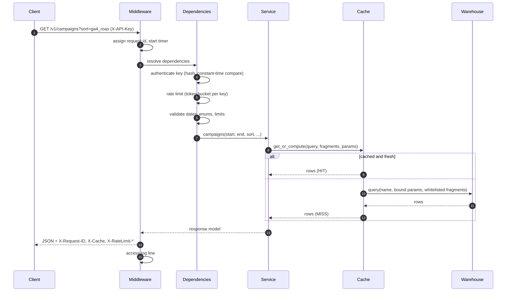

# Design notes

## Request path

## Decisions and trade-offs

### One set of SQL files for two backends
Queries are written once in BigQuery Standard SQL and transpiled to DuckDB for local runs and
tests. The alternative, a query builder or ORM, would hide the SQL that is the point of a
reporting API and would make window functions awkward. The cost is that a local pass proves
the logic but not that BigQuery accepts the statement, so each query was also run in BigQuery
and compared ([bigquery_validation.md](bigquery_validation.md)).

### SQL inside the package
The `.sql` files ship as package data. An earlier layout kept them at the repository root,
which worked in development and broke when the package was installed normally, as it is in
the Docker image. A test that runs the installed package over HTTP caught it.

### Ratios in SQL, changes in Python
CTR, CPC, CPM, CPA and ROAS are computed in SQL from a single shared fragment, because the
campaign list must be sortable by them in the warehouse. Period-over-period changes are
computed in Python from the two period rows, since that is arithmetic on two rows rather than
a query.

Ratios are always computed from summed numerators and denominators, never by averaging daily
ratios. Averaging daily ROAS would weight a day with 10 spend the same as a day with 10,000.

### Totals for pagination in the same query
`count(*) over ()` returns the total alongside each page, so a page costs one query, not two.
The edge case is a page past the end: no rows means no count, so the service asks for the
first row to report an accurate total.

### Search after ranking
The campaign search filter is applied after rank and spend share are computed. A campaign
that is third by spend overall still shows rank 3 when found by search, which is what a
person comparing it to the account expects.

### Sync endpoints
Endpoints are plain `def` functions, so FastAPI runs them in a thread pool. Both warehouse
clients are blocking; wrapping them in `async` would add complexity without adding
concurrency. The cache and rate limiter are lock-protected for that reason, and the DuckDB
backend uses one cursor per call.

### Caching in the process
Reporting tables change once a day and the same dashboard requests repeat, so a short TTL
cache removes most warehouse queries. It is in-process on purpose: no extra infrastructure,
and a stale entry can only be as old as the TTL. Cached values are copied on the way out so a
caller cannot modify what others receive. Two simultaneous misses for the same key both run
the query; that is accepted to avoid holding a lock during a slow call.

### Errors
All errors share the problem-details shape. Validation errors name the field. Warehouse
failures map to 503 or 504 with a generic message; an access-denied message from BigQuery
contains project and table names, and those stay in the log. Unexpected exceptions are caught
in middleware so even a bug produces a well-formed 500 with a request id.

### What authentication covers
Health and readiness are open so orchestrators can probe them. `/docs` and `/openapi.json`
are also open: they describe the API but return no data. Put the service behind an identity-
aware proxy if the schema itself should be private.

## Table contract

The API expects three tables in one dataset.

| Table | Grain | Columns used |
| --- | --- | --- |
| `rpt_paid_media_campaign_daily` | date, platform, campaign_id | `date`, `platform`, `campaign_id`, `campaign_name`, `campaign_type`, `impressions`, `clicks`, `spend`, `platform_conversions`, `platform_conversion_value`, `ga4_sessions`, `ga4_transactions`, `ga4_revenue` |
| `rpt_channel_performance_daily` | date, channel_group | `date`, `channel_group`, `sessions`, `engaged_sessions`, `transactions`, `revenue`, `spend` |
| `campaign_budgets` | campaign_id, month | `campaign_id`, `month` (first day of the month), `budget` |
